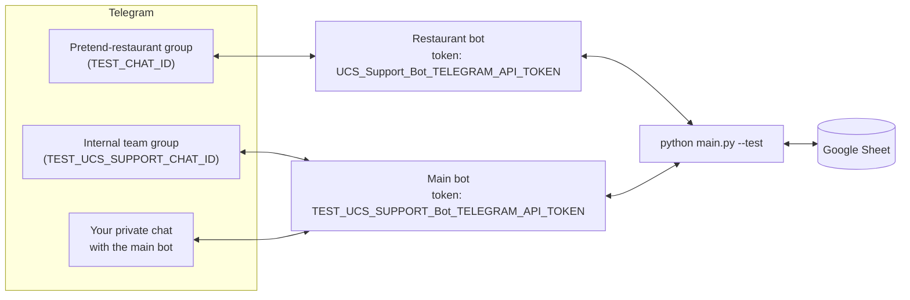

# Getting started

By the end of this page you will have a **working copy of the bot running in test mode**, reacting to messages in a pretend "restaurant" Telegram group. Nothing here touches real restaurants.

**Time needed:** 30–60 minutes, most of it clicking through Telegram and Google settings.

**Contents**

1. [What you need](#1-what-you-need)
2. [Install the project](#2-install-the-project)
3. [Create the Telegram bots](#3-create-the-telegram-bots)
4. [Create the Telegram groups and find their IDs](#4-create-the-telegram-groups-and-find-their-ids)
5. [Set up the Google Sheet](#5-set-up-the-google-sheet)
6. [Fill in the `.env` file](#6-fill-in-the-env-file)
7. [First run](#7-first-run)
8. [Try a full test issue](#8-try-a-full-test-issue)
9. [Where to go next](#9-where-to-go-next)

---

## 1. What you need

| Thing | Why | Notes |
|---|---|---|
| **Python 3.10 or newer** | Runs the bot | Get it from [python.org](https://www.python.org/downloads/). On Windows tick **"Add Python to PATH"** in the installer. This documentation was verified with Python 3.13. |
| **Git** | Downloads the code | [git-scm.com](https://git-scm.com/downloads) |
| **tkinter** | `main.py` imports it even on systems where it isn't used | Included with the python.org installers for Windows and macOS. On Debian/Ubuntu Linux: `sudo apt install python3-tk python3-venv` |
| **Two Telegram accounts** | One plays the *support engineer*, the other plays *restaurant staff* | Your own account + a friend, a colleague, or a second account on another phone. The bot must see two different people. |
| **A Google account** | Hosts the spreadsheet and the API access | |

Test mode needs, in total: **2 bots, 2 groups, 1 spreadsheet** (with 2 tabs). Here is how they relate:



> **Why is the pretend restaurant's token called `UCS_Support_Bot_…`?** In production that token belongs to the main bot. In test mode the roles are swapped to keep production and test bots apart, so test mode needs *two different* tokens. The `.env.example` file explains this again.

---

## 2. Install the project

Open a terminal (Windows: *Command Prompt* or *PowerShell*; macOS/Linux: *Terminal*).

```bash
git clone https://github.com/OneGraund/UCSNotificationCenter.git
cd UCSNotificationCenter
```

Create a **virtual environment** – a private box of Python packages so this project doesn't interfere with other things on your computer:

```bash
python -m venv venv
```

Activate it (do this every time you open a new terminal to work on the project):

```bash
# Windows (Command Prompt)
venv\Scripts\activate

# Windows (PowerShell)
venv\Scripts\Activate.ps1

# macOS / Linux
source venv/bin/activate
```

(If PowerShell refuses to run the script because of its execution policy, just use Command Prompt instead.)

Your prompt now starts with `(venv)`. Install the packages the project needs:

```bash
pip install -r requirements.txt
```

Create the two folders the bot writes to. **They are not part of the git repository, so a fresh download doesn't have them, and the bot crashes without them:**

```bash
mkdir logs
mkdir statistics
```

Quick check that everything installed (should print `OK`):

```bash
python -c "import telebot, gspread, dotenv, holidays, tkinter; print('OK')"
```

If it says `No module named 'tkinter'`, see the tkinter row in the table above.

---

## 3. Create the Telegram bots

Bots are created by chatting with Telegram's official bot-making bot, **@BotFather**.

For test mode, create **two** bots. Repeat these steps twice:

1. In Telegram, search for **@BotFather** (it has a blue check mark) and open it.
2. Send `/newbot`.
3. Give it a display name (e.g. `My UCS Test Main`), then a username that **ends in `bot`** (e.g. `my_ucs_test_main_bot`).
4. BotFather replies with a **token** – a long string like `123456789:AAH...`. This is the bot's password. Copy it somewhere safe for the moment.

Name them so you can tell them apart:

| Bot | Suggested username | Goes into `.env` as |
|---|---|---|
| **Main bot** (talks to your team) | `my_ucs_test_main_bot` | `TEST_UCS_SUPPORT_Bot_TELEGRAM_API_TOKEN` |
| **Restaurant bot** (sits in the pretend restaurant) | `my_ucs_test_restaurant_bot` | `UCS_Support_Bot_TELEGRAM_API_TOKEN` |

### Turn off "Group Privacy" for both bots

By default Telegram only shows a bot the messages addressed to it. This bot must read *every* message in a group, so for each bot:

1. Send `/mybots` to @BotFather and pick the bot.
2. **Bot Settings → Group Privacy → Turn off.**

> If a bot was already added to a group before you changed this, remove it from the group and add it again so the change takes effect.

---

## 4. Create the Telegram groups and find their IDs

### Create the groups

1. **Pretend restaurant:** create a new group (e.g. `UCS Test – Restaurant`) and add the **restaurant bot** and your *second* Telegram account (the "restaurant staff").
2. **Internal team group:** create another group (e.g. `UCS Test – Internal`) and add the **main bot**.

### Find each group's chat ID

The bot needs each group's numeric ID (negative numbers such as `-1001234567890`).

1. Write any message in the group (e.g. `hello`) – *after* the bot was added.
2. Open this address in a browser, replacing `<TOKEN>` with that group's bot token:

   ```text
   https://api.telegram.org/bot<TOKEN>/getUpdates
   ```

3. Find `"chat":{"id":-100…` in the text that appears and copy the number, including the minus sign.

   | Group | Which token to use in the URL | Goes into `.env` as |
   |---|---|---|
   | Pretend restaurant | the **restaurant** bot's token | `TEST_CHAT_ID` |
   | Internal team group | the **main** bot's token | `TEST_UCS_SUPPORT_CHAT_ID` |

If the page shows `"result":[]`, write another message in the group and refresh.

> ⚠️ That address contains your bot token – don't share it or post a screenshot. Do this **before** starting the bot; only one program can read a bot's messages at a time (otherwise Telegram answers `409 Conflict`).

### Find your own Telegram username

The bot recognises engineers by their **@username** (Telegram → Settings → Username). If you don't have one yet, set one – people without a username can't be recognised. Write it **without the `@`**, spelled exactly as Telegram shows it, including capital letters.

---

## 5. Set up the Google Sheet

The bot reads the support schedule from a spreadsheet and writes finished tickets into it. Even test mode needs this.

### 5a. Create the spreadsheet

Create a new Google Sheet. Give the file a name (e.g. `UCS Test`) and create **two tabs** (worksheets), for example `Support` and `SupportData`. Note the three names – they go into `.env` and are case-sensitive.

### 5b. Fill the `Support` tab (who is on duty)

| | A | B | C | D | E |
|---|---|---|---|---|---|
| **1** | Date | | | Payment | Engineer |
| **2** | 28-Oct-2026 | | | | Alex |
| **3** | 29-Oct-2026 | | | | Alex |
| **4** | 30-Oct-2026 | | | | Alex |

- **Column A** – the date as text in the form `29-Oct-2026`: day **without a leading zero** (`5-Oct-2026`, not `05-Oct-2026`), three-letter English month. Easiest: select column A first and set *Format → Number → Plain text*, then type the dates. Alternatively use *Format → Number → Custom date and time* with the format `d-mmm-yyyy`.
- **Column E** – the name of the engineer on duty that day. It must match one of your `EMPLOYEEn_NAME` values in `.env` exactly (case-sensitive).
- Columns B, C and D are not read by the bot, except that **D** is written to on Austrian public holidays (see [Troubleshooting → Known limitations](troubleshooting.md#known-limitations)).

> **There must be a row for today's date, or the bot crashes at startup** (`TypeError: list indices must be integers…`). Fill in a few weeks ahead.

### 5c. Prepare the `SupportData` tab (the ticket log)

Type these headers into row 1, columns A to P. Keep this exact order; the bot addresses columns by position and fills them in itself:

| A | B | C | D | E | F | G | H | I | J | K | L | M | N | O | P |
|---|---|---|---|---|---|---|---|---|---|---|---|---|---|---|---|
| Employee | Year | Month | Day | Time | Response time (s) | Resolution time (s) | Error code | Resolution code | Restaurant | Warning level | Error description | Resolution description | Device | Issue type | Country |

Then do this **one-time trick**: click cell **Q500** and type any character, e.g. `x`.

*Why?* The bot adds each finished ticket in the first row whose column A is empty. Google only sends rows up to the last one containing data, so on a fresh sheet the bot would see no empty row at all and fail on the very first ticket. The marker far below makes Google send 500 rows, leaving plenty of empty ones. (If you ever approach row 500, move the marker further down.)

### 5d. Give the bot access: a service account

A *service account* is a robot Google user that your program logs in as.

1. Go to the [Google Cloud Console](https://console.cloud.google.com/) and create a **new project** (any name).
2. In that project open **APIs & Services → Library**, search for and **Enable** both:
   - **Google Sheets API**
   - **Google Drive API** (the bot finds the spreadsheet by its *name*, which uses Drive)
3. Open **IAM & Admin → Service Accounts → Create service account**. Give it any name and finish the wizard (no extra roles needed).
4. Click the new service account → **Keys → Add key → Create new key → JSON**. A `.json` file downloads.
5. Rename that file to exactly **`service_account.json`** and put it in the project folder (next to `main.py`).
6. Open the file in a text editor and copy the value of `"client_email"` (looks like `name@project.iam.gserviceaccount.com`).
7. In your Google Sheet click **Share**, paste that e-mail address and give it **Editor** access.

The [gspread documentation](https://docs.gspread.org/) describes the same steps in more detail.

### 5e. Test the connection

From the project folder (venv active), replace `UCS Test` with your spreadsheet's name:

```bash
python -c "import gspread; sh = gspread.service_account('./service_account.json').open('UCS Test'); print([w.title for w in sh.worksheets()])"
```

You should see your tab names, e.g. `['Support', 'SupportData']`. If you get an error, see [Troubleshooting → Google Sheets errors](troubleshooting.md#google-sheets).

---

## 6. Fill in the `.env` file

The `.env` file holds all your secrets and settings. Create it from the template:

```bash
# macOS / Linux
cp .env.example .env

# Windows
copy .env.example .env
```

Open `.env` in a text editor. For **test mode** you only need to fill in these variables; leave the restaurant section at the bottom alone:

| Variable | Value |
|---|---|
| `TEST_UCS_SUPPORT_Bot_TELEGRAM_API_TOKEN` | token of your **main** bot |
| `TEST_UCS_SUPPORT_CHAT_ID` | chat ID of the **internal** group |
| `UCS_Support_Bot_TELEGRAM_API_TOKEN` | token of your **restaurant** bot |
| `TEST_CHAT_ID` | chat ID of the **pretend-restaurant** group |
| `GOOGLE_SHEETS_SPREADSHEET_NAME` | e.g. `UCS Test` |
| `GOOGLE_SHEETS_SUPPORT_WORKSHEET_NAME` | e.g. `Support` |
| `GOOGLE_SHEETS_SUPPORTDATA_WORKSHEET_NAME` | e.g. `SupportData` |
| `ALEX_TELEGRAM_USERNAME` | **your** Telegram username (no `@`) |

About the team section in `.env.example`:

- The template lists five engineers (`Alex`, `Egor`, `Vova`, `Ivan`, `Igor`). For testing, put **your** username under `ALEX_…` and make sure the `Support` tab says `Alex` for today's date. Leave the other four people's *values* empty (`EGOR_TELEGRAM_USERNAME=`), but **keep the lines**. The reason is explained in the file itself and in [Troubleshooting → Known limitations](troubleshooting.md#known-limitations).
- Keep the empty `EMPLOYEE6_NAME=` line – it marks the end of the list.
- Don't wrap values in quotes and don't put spaces around `=`.

Every variable is explained in the [Configuration reference](configuration.md).

---

## 7. First run

With the venv active and in the project folder:

```bash
python main.py --test --notify_on_start
```

What the options mean: `--test` runs only the pretend restaurant with fast timings; `--notify_on_start` makes the bot post a hello into the internal group so you can see it works.

**What you should see**

- The terminal fills with lines like `[2026-10-29 07:08:05] - INFO - …` (the same lines are saved in `logs/`).
- Within roughly half a minute (it waits a few seconds on purpose, then connects to Google): `[ALL BOT THREADS STARTED] All specified bots were started 👍`.
- The **internal group** receives three messages: a list of channels (in Russian: *"Бот запущен на этих каналах"* – "Bot started on these channels"), who is on support today (*"Сегодня сапортит …"*), and device info. The channel list shows the production channels even in test mode; ignore that.

To stop the bot press `Ctrl+C`; if it keeps running, close the terminal window (some of its background threads don't exit on their own).

> The bot ignores messages for the first few seconds after starting (5 s in test mode, 75 s in production). That is intentional: Telegram replays old unread messages at startup and the bot must not treat them as new problems.

If it crashes instead, look at the last lines of the error and the [Troubleshooting](troubleshooting.md) page.

---

## 8. Try a full test issue

Keep the bot running. The test timings are **30 s, 60 s, 75 s, 90 s and 105 s** instead of 3–10 minutes.

| # | Who | Does | What you should see |
|---|---|---|---|
| 1 | **Restaurant staff** (second account) | writes `The kiosk does not start` in the pretend-restaurant group | The bot immediately posts `@alex_username` (the engineer on duty) in that group. |
| 2 | nobody | waits 30 s | The log shows *"Changing warning status to warning 1 and calling responsible employee"*. (Real phone calls need the optional phone setup – see [Running in production](running-in-production.md#phone-calls-optional).) |
| 3 | nobody | waits until 60 s | The bot pings the **next** person in the employee list. With empty usernames you'll see a bare `@`; that's fine for a test. |
| 4 | **Engineer** (you) | replies `on it` in the group | Escalation stops. The internal group shows *"Alex is now resolving the issue in test  afterwarning2"* (the number is the warning level you answered at; the missing space before "warning" is just how the message is written). |
| 5 | **Engineer** | writes `done` | The internal group shows *"Issue resolved by Alex in … seconds. Response time: …"*, and a **new row appears in your `SupportData` tab**. |

If you answer `on it` and then stay silent, after 1 minute (30 minutes in production) the bot asks **"Is it done?"** and pings you. After three such reminders without a `done` it closes the issue by itself.

### Try the error-code menus (optional)

When an issue is closed, the bot can ask the engineer **in a private chat** what was broken and how it was fixed. This is switched on with `--req_err_resol`. To try it:

1. Open a private chat with your **main bot** and press **Start**. (Telegram does not let bots message people who haven't started a chat with them.)
2. Send it `/my_id` (the running program answers). It replies with your numeric ID, e.g. `Alex, your Telegram ID is: 123456789`. If it says `False,` instead of your name, your username in `.env` doesn't match your real one – but the number is still correct.
3. Put it into `.env` as `ALEX_TELEGRAM_ID=<number>`.
4. Stop and restart the bot with:

   ```bash
   python main.py --test --notify_on_start --req_err_resol
   ```

5. Run another test issue and write `done`. The main bot now sends *you* a button menu: **device → Software/Hardware → error → fix**. Finish it and the row in the sheet gets its error and resolution codes. More in [Using the bot](using-the-bot.md).

---

## 9. Where to go next

- Learn what is happening behind the scenes: **[How it works](how-it-works.md)**
- Share the commands with your team: **[Using the bot](using-the-bot.md)**
- Go live with real restaurants: **[Configuration reference](configuration.md)** (add restaurants) and **[Running in production](running-in-production.md)**
- Something broke? **[Troubleshooting](troubleshooting.md)**
