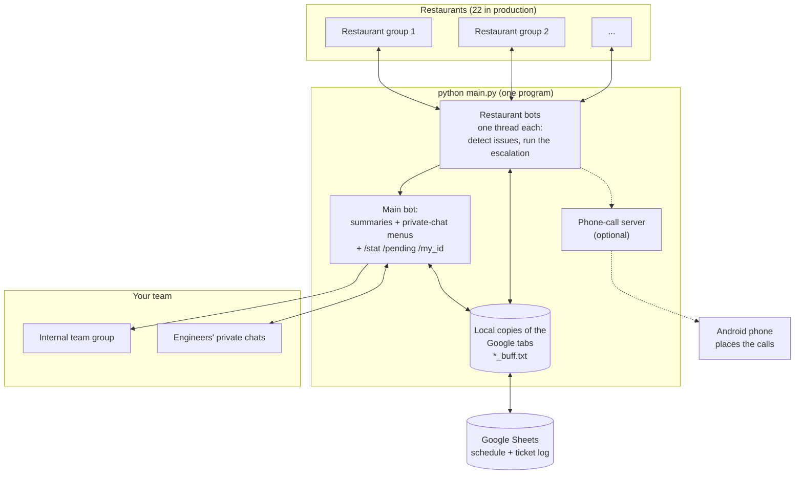
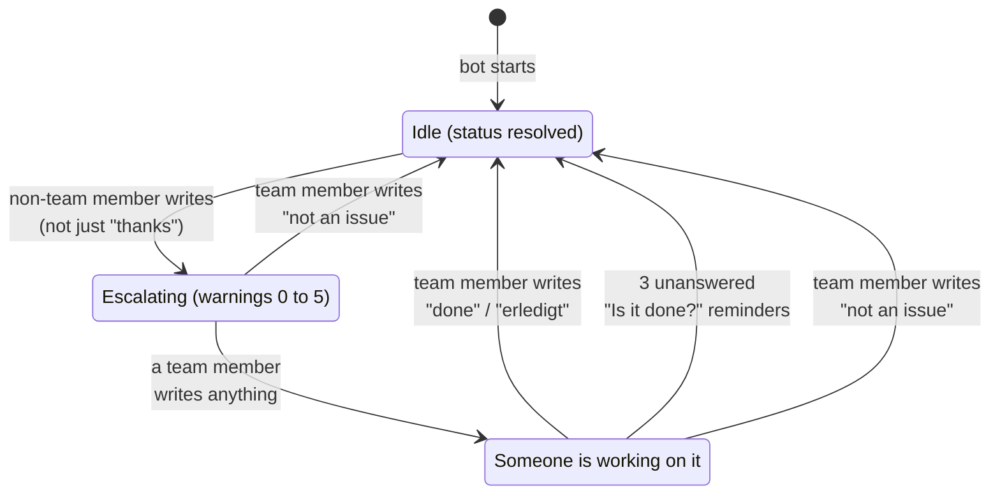

# How it works

This page explains the ideas behind the bot, so the rest of the documentation (and the code) makes sense. No programming knowledge is needed for the first four sections.

**Contents**

1. [The big picture](#1-the-big-picture)
2. [Words you'll see](#2-words-youll-see)
3. [The life of an issue](#3-the-life-of-an-issue)
4. [The escalation timeline](#4-the-escalation-timeline)
5. [What gets recorded when an issue closes](#5-what-gets-recorded-when-an-issue-closes)
6. [Error codes and resolution codes](#6-error-codes-and-resolution-codes)
7. [Under the hood (for developers)](#7-under-the-hood-for-developers)
8. [Code map](#8-code-map)
9. [Files the bot creates](#9-files-the-bot-creates)

---

## 1. The big picture

One Python program (`main.py`) runs **many Telegram bots at once**:

- **One bot per restaurant.** Each sits in that restaurant's Telegram group and watches every message.
- **One "main" bot.** It talks to *your* team: it posts summaries into the internal team group and chats privately with engineers to collect error codes.



In words: restaurant staff write in their group → the restaurant bot notices → it pings and escalates inside that group → when the issue is closed, the main bot reports to your team and the result goes into the Google Sheet.

---

## 2. Words you'll see

| Word | Meaning |
|---|---|
| **Channel** (spelled "chanel" in the code) | One restaurant's Telegram group, together with the bot that watches it. |
| **Main bot / main channel** | The bot and the internal group used by your own team (`UCS_AUSTRIA_CHAT_ID`). |
| **Employee / engineer / UCS** | A member of the support team, listed in `.env`. The bot recognises them by their Telegram `@username`. |
| **On duty / "supporting today"** | The engineer named in the `Support` tab of the Google Sheet for today's date. They are the first to be pinged. |
| **Issue / ticket** | A problem reported in a restaurant group, from the first message until someone closes it. |
| **Status** | `resolved` (nothing open – the normal state), `unresolved` (an issue is open). Two more exist for special cases: `unknown` (only with `--spec_stat`) and `locked` (no longer used). |
| **Warning level** | How far the escalation has gone: `warning0` (just reported) … `warning5` (last step). `no warning` means *someone has reacted*. |
| **Ping** | The bot writes `@username` in the group, so Telegram notifies that person. |
| **Call** | The bot asks an Android phone to ring that person's number (optional feature). |
| **Priority** | The position in the team list: priority 0 = the person on duty, 1 = the next person, … |
| **Buffer** | A local text copy of a Google tab (`<tab name>_buff.txt`), refreshed every few minutes, so the bot doesn't ask Google for every little thing. |
| **Error code / resolution code** | A 4-digit number describing *what broke* / *how it was fixed* (see [section 6](#6-error-codes-and-resolution-codes)). |

---

## 3. The life of an issue

Every restaurant channel is always in one of these situations:



The rules the bot applies to **every message** in a restaurant group, in this order:

| # | If... | then... |
|---|---|---|
| 1 | the channel is `resolved` and the sender is **not** a team member and the message is **not** just a thank-you | **New issue.** Status becomes `unresolved`, warning level `warning0`, the engineer on duty is pinged, and the escalation timer starts. |
| 2 | the sender **is** a team member and the whole message is exactly `not an issue`, `not a issue` or `lock` (any capitalisation) | The issue is dismissed. Status goes back to `resolved`, the timer stops, the bot answers *"Okay, issue removed"*. **Nothing is written to the Google Sheet.** |
| 3 | the sender is a team member, an issue is open, and the escalation is still running (any warning level) | **Acknowledged.** The escalation stops, the response time is noted, and the main channel is told *"X is now resolving the issue"*. This happens on the team member's **first** message, whatever it says – even `done`. |
| 4 | the sender is a team member, an issue is open, and **no escalation is running**, and the message contains `done` or `erledigt` | **Resolved.** See [section 5](#5-what-gets-recorded-when-an-issue-closes). |
| 5 | anything else | It's just conversation. The bot does nothing. |

Things worth knowing:

- **"Thank you" detection:** a message containing `thanks`, `thank`, `danke` or `dank` is *not* a new issue – unless it also contains a greeting (`hi`, `hello`, `hallo`, `hey`). Both checks look for the letters anywhere in the message, so `thanks, this works now` counts as a **new issue** (the "hi" inside "this" looks like a greeting).
- **Which messages are seen:** text, photos and videos. For a photo, the caption is read as its text. Stickers, voice messages and file attachments are ignored.
- **`done` is a "contains" check, not a whole-word check.** `not done yet` or `abandoned` also close the issue. Avoid the letters *d-o-n-e* in other sentences while an issue is open.
- **Because of rule 3, an engineer who replies `done` straight away to the first alert only acknowledges it.** They must write `done` a second time to close it.
- **Reminders:** once someone has acknowledged, the bot waits for silence. After **30 minutes** without any message in the group (1 minute in test mode) it writes **"Is it done?"** and pings the engineer who answered. After **3 reminders in a row** with no reply, it closes the issue itself, recorded as fixed by `Bot`.
- **Memory:** the status of every channel lives only in the program's memory. If the bot is restarted, every channel starts as `resolved` and open issues are forgotten (unless started with `--spec_stat`, which asks each channel for its status).

---

## 4. The escalation timeline

Starting from the moment the issue is reported (times are **minutes after the first message**, not after the previous step):

| Time (production) | Time (`--test`) | Warning level | What the bot does |
|---|---|---|---|
| 0:00 | 0:00 | `warning0` | **Pings** priority 0 – the engineer on duty |
| 3:00 | 0:30 | `warning1` | **Calls** priority 0 |
| 5:00 | 1:00 | `warning2` | **Pings** priority 1 |
| 7:00 | 1:15 | `warning3` | **Pings** priority 2 **and calls** priority 1 |
| 8:00 | 1:30 | `warning4` | **Pings** priority 3 |
| 10:00 | 1:45 | `warning5` | **Calls** priority 3. This is the last step; the timer stops. |

The moment a team member writes anything in the group (rule 3 above) the timer stops and none of the later steps happen.

**Who is priority 0, 1, 2, 3?** The team list from `.env` (`EMPLOYEE1_NAME`, `EMPLOYEE2_NAME`, …) is re-ordered **once, when the bot starts**: the person on duty that day (from the Google Sheet) moves to the front, everyone else keeps their relative order. The bot does **not** look at the sheet again at midnight, so a bot that keeps running for several days keeps pinging the person who was on duty on the day it was started. Restart it whenever the duty changes (for example every morning). If your list has fewer than four people, the steps that need a missing priority are skipped and a "wrong priority" message appears in the log or console.

The times live in `PROD_TIMINGS` and `TEST_TIMINGS` at the top of `main.py` (in minutes).

Pings need nothing special. **Calls only work if the optional phone setup is running** – see [Running in production](running-in-production.md#phone-calls-optional). Without it, the "call" steps just write a request file that nobody picks up.

---

## 5. What gets recorded when an issue closes

When a team member writes `done` (or the bot auto-closes after 3 reminders), the bot:

1. **Posts a summary in the main channel**, for example:

   ```text
   kfc woergl
   Issue resolved by Ben in 4 minutes 12 seconds.
   Response time: 2 minutes 3 seconds
   ```

2. **Adds a row to the `SupportData` tab** of the Google Sheet: engineer, date, time, response time, resolution time, restaurant, the warning level at which the engineer reacted, and the restaurant's country code. (Column layout: [Configuration → Google Sheet layout](configuration.md#google-sheet-layout).)
3. **Appends a line to `statistics/<engineer>.txt`** (lower-case name, e.g. `statistics/ben.txt` – a simple text log per engineer).
4. **If started with `--req_err_resol`**, opens a conversation in the engineer's **private chat** with the main bot, asking for the device, software/hardware, error and fix – then fills in the error/resolution columns of that same sheet row. See [Using the bot](using-the-bot.md#after-you-close-an-issue-the-code-menus).

Definitions: **response time** = from the first message until a team member first reacted; **resolution time** = from the first message until `done`.

---

## 6. Error codes and resolution codes

To make statistics possible, each closed issue is labelled with **what broke** and **how it was fixed**, using two lists that live in the project: `error_codes.json` and `resolution_codes.json`.

A code is **four digits, `AABB`**:

- **`AA`** – which *device* and whether the problem was *software* or *hardware* (each device uses two numbers in a row).
- **`BB`** – the running number inside that group.

| `AA` | Device | Type |  | `AA` | Device | Type |
|---|---|---|---|---|---|---|
| 01 | Kiosk | Software |  | 08 | KDS | Hardware |
| 02 | Kiosk | Hardware |  | 09 | QMS | Software |
| 03 | Kassa | Software |  | 10 | QMS | Hardware |
| 04 | Kassa | Hardware |  | 11 | SERVER | Software |
| 05 | GuestScreen | Software |  | 12 | SERVER | Hardware |
| 06 | GuestScreen | Hardware |  | 13 | Phones | Software |
| 07 | KDS | Software |  | 14 | Phones | Hardware |

Examples:

- Error `0102` = Kiosk · Software · *"Kiosk did not start"*. Resolution `0102` = Kiosk · Software · *"Restart Kiosk application"*.
- Error `1201` = SERVER · Hardware · *"HDD/SSD malfunction"*.
- **`0000`** is special: it means **"Not an issue"** (the engineer picked *Not an issue* in the menu).

Error and resolution codes are numbered separately, so `0102` in the error column and `0102` in the resolution column are different lists. In the JSON files you'll see the prefix `Error` or `Resol` in front of the number; only the four digits are stored in the sheet and the prefix doesn't matter.

New codes can be added by engineers straight from the chat menu (the bot picks the next free number) or by editing the JSON files – see [Configuration → Adding codes](configuration.md#adding-error-and-resolution-codes).

---

## 7. Under the hood (for developers)

### Threads: what runs at the same time

The program is built from **threads** (little parallel workers inside one Python process):

| Thread | Started by | Job |
|---|---|---|
| main thread | – | Reads command-line options, creates the sheet objects and bots, starts the other threads, then ends. |
| One per restaurant channel | `start_bot_chanel_threads()` in `bot.py` | Creates a `TelegramChanel`, which registers a message handler and then blocks in `bot.polling()` forever. |
| `sender` (one per channel) | `TelegramChanel.__init__` | Once a second: checks if an "Is it done?" reminder is due. |
| `warning_thread` (one per open issue) | the message handler, when an issue opens | Counts seconds and fires warning levels 1–5. Stopped through a `threading.Event`. |
| `personal_chat_monitoring_thread` | `UCSAustriaChanel.__init__` | Polls the main bot once a second for `/my_id`, `/stat`, `/pending`, `/killyourself`. |
| `buff_updater` (two) | `Worksheet.__init__` | Every N minutes copies the whole Google tab into its local `*_buff.txt` file. |
| `update_holiday_payment` | `SupportWKS.__init__` | Once a day, writes the holiday payment on Austrian public holidays. |
| telephony server (optional) | `main.py` with `--telephony` | TCP server that forwards call requests to the phone. |
| Control Panel (Windows only) | `main.py` | The small Kill / Update window. |

### The sheet buffer, and why it matters

Reading a Google Sheet is slow and rate-limited, so `sheets.py` keeps a **local copy** of each tab in `<tab name>_buff.txt` and refreshes it every `--wks_upd_interval` minutes (default 5). Almost all reads use the copy; all writes go to Google directly.

The consequence: **after the bot writes a row, the copy doesn't contain it until the next refresh.** Two issues closed within the same refresh window therefore both pick the same "first empty row" (see [Known limitations](troubleshooting.md#known-limitations)).

### Test mode vs. production

| | `--test` | production |
|---|---|---|
| Restaurant channels started | only `TestChanel` (`TEST_CHAT_ID`) | the 22 real ones |
| Main bot / chat | `TEST_UCS_SUPPORT_Bot_TELEGRAM_API_TOKEN` / `TEST_UCS_SUPPORT_CHAT_ID` | `UCS_Support_Bot_TELEGRAM_API_TOKEN` / `UCS_AUSTRIA_CHAT_ID` |
| Escalation times | `TEST_TIMINGS`: 0.5, 1, 1.25, 1.5, 1.75 min | `PROD_TIMINGS`: 3, 5, 7, 8, 10 min |
| "Is it done?" interval | 1 min | 30 min |
| Ignore messages after start | 5 s | 75 s |

### Two Python details that surprise beginners

- **`statistics.py` shadows a standard-library module of the same name.** `import statistics` in this project loads *our* file, not Python's maths module. It works because Python looks in the project folder first. Don't rename it without updating the imports in `bot.py` and `sheets.py`.
- **The code uses relative file paths** (`.env`, `service_account.json`, `error_codes.json`, `logs/`, …), so the program must be started from the project folder.

---

## 8. Code map

| File | Lines (approx.) | What's inside |
|---|---|---|
| `main.py` | 230 | `channel_params` (the list of restaurants), the command-line options, startup sequence, employee list loading. |
| `bot.py` | 1200 | `TelegramChanel` – one restaurant: message rules, warnings, reminders, closing an issue. <br/> `UCSAustriaChanel` – the main bot: summaries, the private-chat code menus (`request_problem_resoluion_codes`), chat commands. <br/> `is_from_ucs`, `is_thank_you`, `is_resolution_message` – the small helpers behind the rules in section 3. <br/> `start_bot_chanel_threads` – launches everything. |
| `sheets.py` | 350 | `Spreadsheet` → `Worksheet` → `SupportWKS` (who is on duty, holiday pay) and `SupportDataWKS` (ticket rows, statistics queries, pending tickets). Buffer logic. |
| `statistics.py` | 320 | Reading/writing the two JSON code lists, adding new codes, `/stat` date parsing and message formatting. |
| `sip_call.py` | 125 | `call_employee_with_priority()` (writes `call_request.txt`) and `start_telephony_server()` (TCP server). |
| `cellphone_clientcaller.py` | 60 | Runs on the Android phone (Termux), connects to the server, dials numbers. |
| `gui.py` | 55 | Tkinter window with Kill and Update buttons. |
| `utils.py` | 80 | Date/time helpers, `Logger`, device info for the start-up message. |

The Windows `.bat` scripts in `windows_console_managment/` are described in [Running in production](running-in-production.md).

### Where do I change…?

| I want to change… | Look at |
|---|---|
| when people are pinged or called | `PROD_TIMINGS` / `TEST_TIMINGS` in `main.py` (when) and `warning_thread` in `bot.py` (who, at each level) |
| which words close or dismiss an issue | `is_resolution_message` and `monitor_incoming` in `bot.py` |
| which messages count as "thanks" | `is_thank_you` in `bot.py` |
| how an engineer is recognised | `is_from_ucs` in `bot.py` (reads the Telegram usernames from `.env`) |
| a chat command, or a new one | `personal_chat_monitoring_thread` in `UCSAustriaChanel` (`bot.py`) |
| the texts the bots send | search for `send_message` in `bot.py` |
| what is written to the Google Sheet | `upload_issue_data` and `update_problem_resolution_codes` in `sheets.py` |
| the `/stat` report | `format_statistics` and `parse_command_date` in `statistics.py` |
| the list of restaurants | `channel_params` in `main.py` (see [Adding a restaurant](configuration.md#adding-a-restaurant)) |

### Making changes safely

- The project has **no automated tests**. The safe way to try a change is **test mode** (`python main.py --test`) with your own test bots and a copy of the Google Sheet ([Getting started](getting-started.md)), plus reading the log file.
- Never run a second copy with the production tokens while the real bot is running.
- Work on a git branch and keep `.env` and `service_account.json` out of your commits.

---

## 9. Files the bot creates

All of these appear in the project folder while it runs. None are committed to git.

| File / folder | Created by | Contents |
|---|---|---|
| `logs/logsDD_MM_YYYY_.log` | `Logger` | One log file per day, also printed to the console. **You must create the `logs/` folder yourself.** |
| `statistics/<engineer>.txt` | closing an issue | One line per closed issue per engineer. **You must create the `statistics/` folder yourself.** |
| `<tab name>_buff.txt` (two) | `Worksheet` | Local copies of the Google tabs. Safe to delete while the bot is stopped. |
| `call_request.txt` | `sip_call.py` | The phone number the phone should call next (or `None`). |
| `restart_permission.txt` | closing an issue | Contains the word `Permited`. Nothing in the project reads it. |
