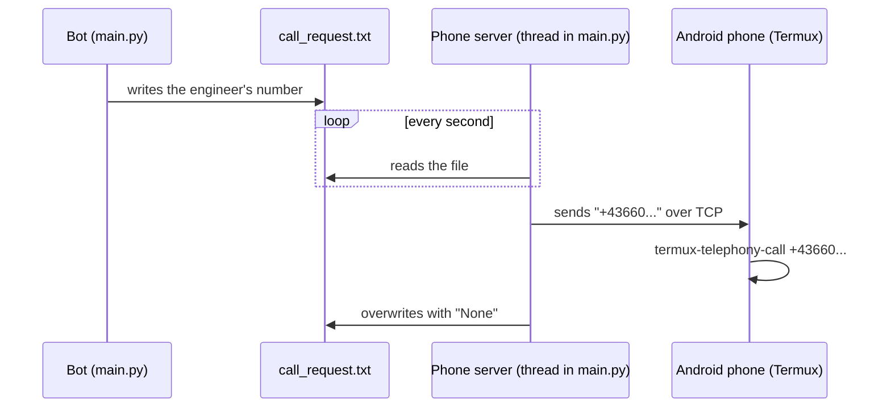

# Running in production

How to run the bot for real restaurants, keep it running, update it, and (optionally) make it phone people.

**Contents**

1. [The setup this project was built for](#1-the-setup-this-project-was-built-for)
2. [The Windows scripts](#2-the-windows-scripts)
3. [The Control Panel window](#3-the-control-panel-window)
4. [Starting, stopping and updating](#4-starting-stopping-and-updating)
5. [Daily routine and checklist](#5-daily-routine-and-checklist)
6. [Phone calls (optional)](#phone-calls-optional)
7. [Security checklist](#7-security-checklist)

---

## 1. The setup this project was built for

- **One always-on Windows PC** that has Python and Git installed and a clone of this repository, plus the `.env` file and `service_account.json`.
- **One single running copy** of the program. A Telegram bot token can only be read by one program at a time – if you start a second copy (say, on your laptop) with the same tokens, Telegram answers with `409 Conflict` errors and **the two copies keep interrupting each other, so messages get lost**. For experiments use `--test` with separate test bots ([Getting started](getting-started.md)).
- Everything the bot knows about open issues is kept **in memory**. Restarting the bot forgets all open issues (every restaurant starts as "resolved"). See `--spec_stat` in the [command-line options](configuration.md#3-command-line-options) for the careful way to restart during the day.

The core program is plain Python and also runs on Linux or macOS. Only the `.bat` scripts and the Control Panel window are Windows-specific. (On Linux you still need the `tkinter` package, because `main.py` imports it.)

---

## 2. The Windows scripts

They live in `windows_console_managment/` (the spelling is the project's own). Each one is a few lines you can open in Notepad.

| Script | What it does | Options it starts the bot with |
|---|---|---|
| `run_bot.bat` | Stops all Python programs → goes to the project folder → `pip install -r requirements.txt` → starts the bot. **Does not** run `git pull`. | `--disable_notifications --wks_upd_interval 10 --wks_output_upd --req_err_resol` |
| `update.bat` | Stops all Python programs → `git pull` → `pip install -r requirements.txt` → starts the bot. This is what the Control Panel's **Update** button runs. | `--disable_notifications --notify_on_start --wks_upd_interval 2 --wks_output_upd` |
| `run_bot_test.bat` | Like `update.bat`, but in test mode. | `--disable_notifications --notify_on_start --wks_upd_interval 2 --wks_output_upd --test` |
| `update_test.bat` | Identical to `run_bot_test.bat`. | same |
| `kill_py.bat` | `taskkill /IM python.exe /F` – stops everything. | – |
| `restart_bot.bat` | Empty file. | – |

> ⚠️ **Read before using:**
>
> - **They kill every Python program on the PC** (`taskkill /IM python.exe /F`), not just this bot. Don't run them on a computer that runs other Python things.
> - **The folder is hard-coded** as `C:\Users\Rkeeper\UCSNotificationCenter` in each script. Change the `cd` line to your folder first.
> - **The scripts differ in their options.** In particular `update.bat` does *not* include `--req_err_resol`, so after pressing **Update** the private code menus are switched off until someone starts the bot with `run_bot.bat`. And **no script includes `--telephony`**, so phone calls are off unless you add it yourself.
> - They use the Python that is on the PC's `PATH`, not a virtual environment.

Make your own copy of `run_bot.bat` with exactly the options you want, for example:

```bat
@echo off
taskkill /IM python.exe /F
cd C:\path\to\UCSNotificationCenter
git pull
pip install -r requirements.txt
start "" /B python -u main.py --disable_notifications --notify_on_start --wks_upd_interval 10 --req_err_resol --telephony
```

(`start "" /B` runs the bot in the background of the same window; `-u` makes Python print immediately instead of in chunks.)

---

## 3. The Control Panel window

On Windows, `main.py` opens a small dark window titled **Control Panel** with two buttons:

| Button | Does |
|---|---|
| **Kill** | Stops the bot immediately. |
| **Update** | Runs `windows_console_managment/update.bat` (see the warning above about its options). |

Keep that window open on the server's desktop; it's the quickest way to stop or update the bot. It's created only on Windows. The same "stop now" function exists in Telegram: the `/killyourself` command (team members only).

---

## 4. Starting, stopping and updating

**Start:** double-click your `run_bot.bat`, or in a terminal in the project folder: `python main.py <options>`. Wait for `[ALL BOT THREADS STARTED]` in the output. During the first 75 seconds the restaurant bots deliberately ignore messages (see [Getting started → First run](getting-started.md#7-first-run)).

**Stop:** the Control Panel's **Kill**, `/killyourself`, `kill_py.bat`, or close the window. (`Ctrl+C` alone may not stop all background threads.)

**Update to a newer version of the code:**

1. Press **Update** in the Control Panel (or run `update.bat`). It pulls the latest code, installs any new packages and restarts the bot.
2. If `git pull` complains that local changes would be overwritten, the bot has added entries to `error_codes.json` or `resolution_codes.json` on this machine. See [Configuration → These files and git](configuration.md#these-files-and-git).
3. Watch the output until `[ALL BOT THREADS STARTED]` appears, and check that the internal group received the start-up message (if you used `--notify_on_start`).

---

## 5. Daily routine and checklist

**The on-duty person is looked up only once, at startup.** The bot reads "who is on duty today" from the `Support` tab when it starts, and never again. If the bot runs for several days without being restarted, it keeps pinging the person who was on duty the day it started. Until this changes in the code, **restart the bot every morning** (or whenever the duty changes), for example with Windows Task Scheduler running `run_bot.bat`. Combine it with `--spec_stat` if incidents may be open at that moment.

Checklist:

- [ ] The `Support` tab has a row for **today** (and the next days). If today's row is missing, the bot crashes at startup with `TypeError: list indices must be integers…`.
- [ ] Exactly one copy of the bot is running.
- [ ] Look at today's log file `logs/logsDD_MM_YYYY_.log` now and then. Lines are tagged `DEBUG`, `INFO`, `WARNING`, `ERROR`, `CRITICAL`; search for `ERROR` and `CRITICAL` first. A new file is started every day; delete old ones occasionally.
- [ ] `SupportData` still has blank rows below the last ticket (the marker cell, see [Getting started → 5c](getting-started.md#5c-prepare-the-supportdata-tab-the-ticket-log)).
- [ ] Back up `.env`, `service_account.json`, `error_codes.json` and `resolution_codes.json`. They're the parts that can't be re-downloaded from git.

Nothing in the project restarts the bot automatically after a crash or a PC reboot. A Windows Task Scheduler task that runs your start script at log-on is a simple way to add that (this is a suggestion; it's not part of the project).

---

<a id="phone-calls-optional"></a>

## 6. Phone calls (optional)

The escalation can **ring the engineer's phone** (at levels 1 and 3 and 5; see [the timeline](how-it-works.md#4-the-escalation-timeline)). There's no telephony provider involved: an ordinary Android phone with a SIM card does the dialing.

### How it works



1. When the escalation reaches a "call" step, the bot writes the engineer's phone number (`<NAME>_MAINCELLPHONE_NUMBER` in `.env`) to the file `call_request.txt`.
2. The **phone server** (started by `--telephony`) checks that file every second and sends any number it finds to every connected phone.
3. The **phone client**, `cellphone_clientcaller.py`, runs on the Android phone inside **Termux** and dials the number with `termux-telephony-call`.

Without `--telephony` the "call" steps still write the file, but nothing reads it.

### What you need

- An Android phone with a SIM card that is allowed to call the engineers' numbers, kept powered and connected to the same network as the PC (or a network that can reach it).
- The **Termux** and **Termux:API** apps. Install both from the same source and follow the Termux project's current installation instructions (it has recommended F-Droid over the Play Store). Grant Termux:API the *Phone* permission in Android's app settings.
- In Termux: `pkg install python termux-api git`
- The PC's firewall must allow incoming TCP connections on the chosen port (default `10000`).

### Setup

1. **Start the bot with `--telephony`**. By default the server listens on the PC's own IPv4 address and port 10000. You can pick them with `--telephony_ip` and `--telephony_port`. The output shows `[CALLING SERVER] Starting calling server at (...)`.
2. **On the phone**, in Termux, get the script (e.g. `git clone https://github.com/OneGraund/UCSNotificationCenter.git`) and run it, **port first, then the PC's address**:

   ```bash
   cd UCSNotificationCenter
   python cellphone_clientcaller.py 10000 192.168.1.20
   ```

   With no arguments the script uses a hard-coded address (`DEFAULT_HOST` at the top of the file, currently `192.168.192.114`), so edit that or always pass the arguments.
3. The phone prints `Connected to 192.168.1.20:10000`. If the PC isn't reachable yet it retries every 5 seconds, and it reconnects by itself after a disconnect.
4. Make sure each engineer's `<NAME>_MAINCELLPHONE_NUMBER` in `.env` is in international format with a plus sign and 10–15 digits (`+436601234567`). Numbers in any other shape are not dialled by the phone script.

### Known problem: calls may not start

In the current code the server sends the number **followed by a line break**, but the phone script's check (`is_valid_phone_number`) only accepts text that is *exactly* a plus sign and 10–15 digits. Running that check on `"+436601234567\n"` returns *invalid*. If it behaves the same on the phone, the number is printed in Termux but **no call is placed**. This was checked on the validation function only, not on a real phone – so test a call before relying on this feature. The likely fix is to strip whitespace from the received text before validating it (`data_str = data.decode().strip()` in `cellphone_clientcaller.py`).

### Telephony security

The phone server has **no password**. Anyone who can reach its port can connect, receive the phone numbers being called, and send text that is forwarded to every other connected client. Use it only on a trusted internal network, never forward the port from the internet, and keep `call_request.txt` private – it contains personal phone numbers.

---

## 7. Security checklist

- `.env` and `service_account.json` are in `.gitignore`. Never remove them from it, never send them in a chat or screenshot.
- Restaurant groups should contain only the restaurant's staff, the bot and your engineers. Anyone in the group can trigger alarms.
- If a bot token leaks, open @BotFather → `/mybots` → the bot → **API Token → Revoke current token**, then put the new token in `.env` and restart.
- The service account only needs access to the one spreadsheet (share only that file with it).
- Only team members can use `/killyourself`, but see [the known limitation](troubleshooting.md#known-limitations) about how that check works – make sure all five legacy username variables are defined in `.env`.
